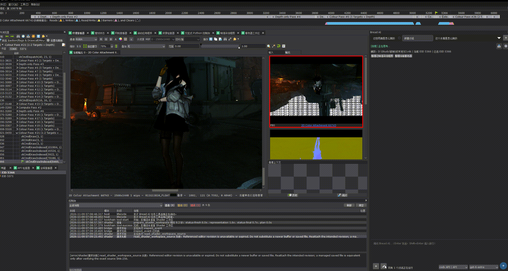
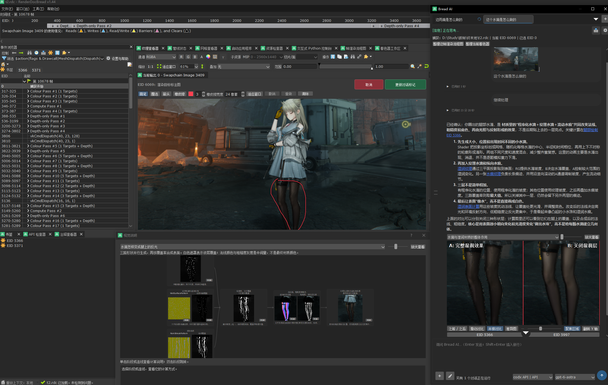
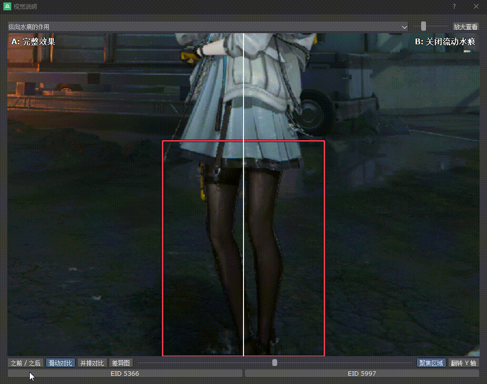
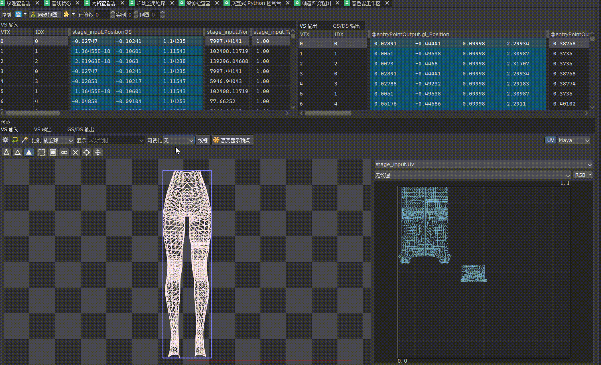

# RenderDocBread

RenderDoc 史诗升级，内嵌 AI、调试工具，快使用它来调试渲染吧！

直接在捕获帧中提问，让 AI 分析渲染流程、整理和调试 Shader、动态调整 CBuffer；也可以让 AI 将选定的渲染效果移植到 Unity，搭建可编辑的场景，再对照画面逐步调整。

📖 [完整介绍与使用教程：RenderDocBread 史诗升级（知乎）](https://zhuanlan.zhihu.com/p/2098534987763131428)

## 下载

在 [Releases](https://github.com/Straw1997/renderdocBread/releases/latest) 下载 Windows x64 完整便携版和 SHA-256 校验文件。解压后运行 `RenderDocBread.exe`。

## 效果演示

### 一句话在 Unity 中还原渲染

从捕获中分析模型、纹理、Shader 和参数，在 Unity 中还原并对照效果。

<!-- bread-video:unity-restoration:begin -->

https://github.com/user-attachments/assets/74984035-3306-43dd-b3bd-e33d555f3b32

<!-- bread-video:unity-restoration:end -->

[MP4 文件：Unity 效果还原演示（约 25 秒，含音轨）](docs/media/bread/unity-restoration.mp4)

<!-- bread-video:unity-frame-debugger:begin -->

https://github.com/user-attachments/assets/22e66080-ca93-40d0-ab08-dcc3c5565b2a

<!-- bread-video:unity-frame-debugger:end -->

[MP4 文件：Unity Frame Debugger 绘制过程（约 15 秒，含音轨）](docs/media/bread/unity-frame-debugger.mp4)

复杂的光照、后处理和历史帧效果仍需要结合捕获内容分析、移植与校准。

### RenderDoc 中直接使用 AI

在同一个窗口中查看捕获、阅读整理后的 Shader，并让 Bread AI 调用工作流与工具继续分析。

### Shader 可视化调试

选择代码中的变量或计算结果，直接输出到画面，观察这一部分对渲染的影响。

### CBuffer 参数动态调整

为参数整理可读名称，修改数值后实时观察捕获画面的变化。

### 帧渲染流程图

把一帧中的绘制阶段、输入输出纹理和关联事件串起来，点击查看对应内容。

### 那里不懂圈那里

在渲染目标（RT）上用画笔、圈选或箭头标出想问的位置，直接问 Bread AI「这里的水滴是怎么做的？」AI 会结合标记和捕获数据分析对应的绘制与计算。回复可以用流程图、关键代码和滑动对比展示各层效果，并跳转到相关事件、纹理或 Shader。

### 网格查看器

并排查看 3D 网格和 UV 展开图。点、边、面的选择在两侧同步高亮，可切换顶点着色器输入与输出，并用捕获中的纹理及其通道检查 UV 映射。

*图示来自演示版本，界面以当前版本为准。*

## 新增与拓展

| 功能 | 可以做什么 |
| --- | --- |
| **Bread AI** | 在 RenderDoc 内对话，使用 Skills、MCP 和内置工具分析捕获；支持模型 API 与 Agent 订阅连接。 |
| **项目与资源关联** | 保存项目中的 Shader、参数别名与分析成果；关联解包资源，辅助查找模型、纹理和材质信息。 |
| **着色器工作区** | 将 Shader 整理为可读函数、计算目录和流程图，编辑、编译、替换并观察渲染结果。 |
| **Shader 与 CBuffer 调试** | 可视化查看中间计算结果，动态调整参数，定位画面差异。 |
| **帧渲染流程图** | 由 AI 梳理 Pass、事件和资源关系，在应用中查看通道详情、跳转事件并导出流程图图片。 |
| **那里不懂圈那里** | 在渲染目标上标记后向 Bread AI 提问，用流程图、滑动对比和可跳转的关键代码查看效果是怎么做出来的。 |
| **网格查看器** | 3D 与 UV 同步选择点、边和面，查看顶点着色器输入与输出，以及捕获纹理的通道。 |
| **Unity 效果还原** | 导出并移植模型、纹理、Shader 和参数，搭建材质、预制体与场景；自动准备 Unity MCP 连接，断线后恢复并继续处理。 |
| **日常调试改进** | 事件过滤、书签与 Shader 跳转、RT 历史、像素检查，以及中英界面和黑色主题。 |
| **智能体监视器** | 查看 AI 任务、工具调用和执行状态，方便跟进分析过程。 |

查看智能体监视器

## 从源码构建

普通 `git clone` 会包含完整的封存依赖分卷，构建入口会自动离线还原和校验，无需从 Release 单独下载依赖或运行 Git LFS。开发机需安装 Visual Studio C++、Windows SDK、64 位 Python 3.12 和 .NET SDK；运行 `PACKAGE_RENDERDOCBREAD.cmd`，具体版本和步骤见[构建说明](replaylab/packaging/README.md)。

基于 [RenderDoc](https://github.com/baldurk/renderdoc) 拓展。首方代码许可证见 [LICENSE.md](LICENSE.md)，随附依赖按各自许可证与通知分发。
